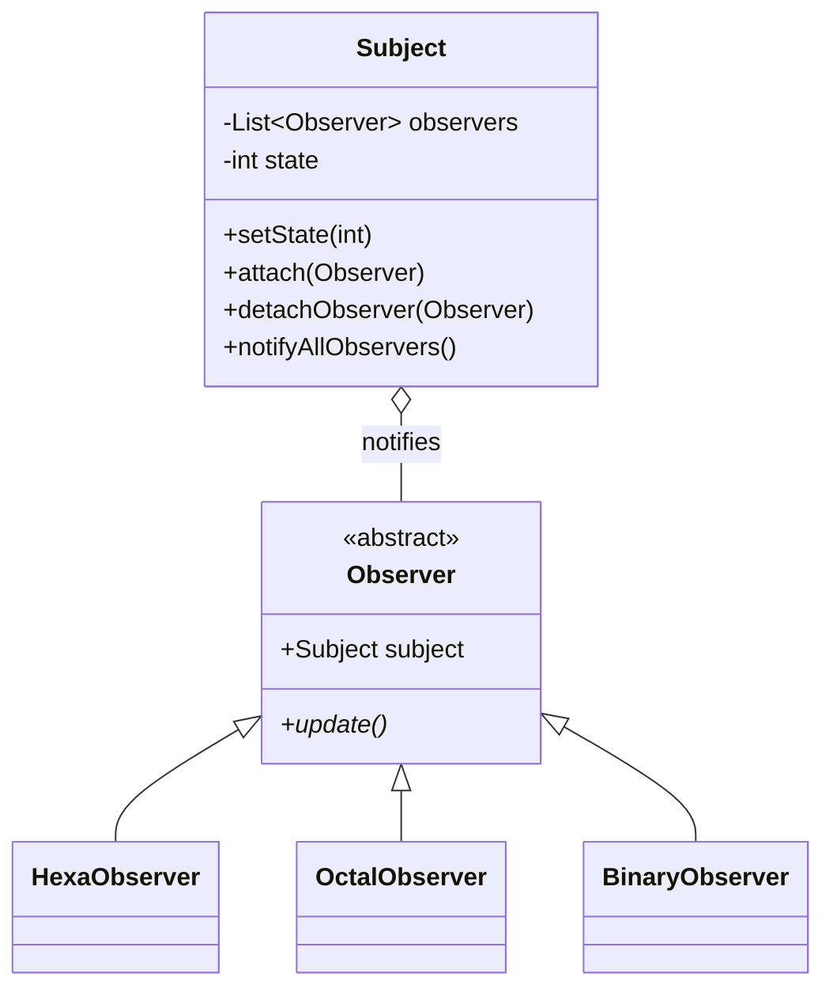
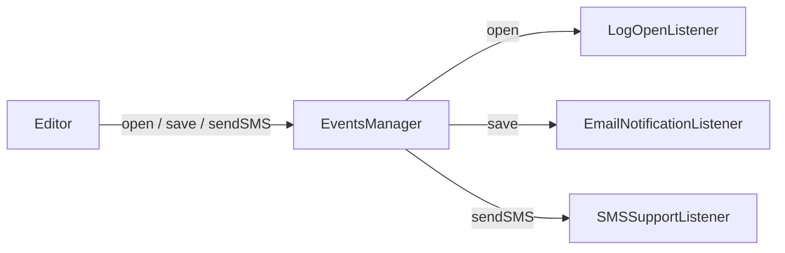

<div align="center">

# Observer Design Pattern in Java

Two worked implementations of the **Observer** pattern, from basic to event-based,<br>
written for the *Software Design & Architecture* course at COMSATS University Islamabad.


</div>

---

## What's inside

| Package | Idea | Entry point |
| :-- | :-- | :-- |
| [`Observer/`](Observer) | One subject, many observers. When the subject's number changes, each observer prints it in its own base: hex, octal or binary. Observers attach and detach **themselves**. | `Observer.ObserverPatternDemo` |
| [`eventsManagement/`](eventsManagement) | An editor publishes named events (`open`, `save`, `sendSMS`) through an `EventsManager`. Each listener subscribes only to the events it cares about. | `eventsManagement.Demo` |

---

## 1 · Basic Observer: number in three bases



Each observer is handed a `Subject` in its constructor and subscribes itself. Its own `detach()` method unsubscribes it again, and it says so if it was never subscribed.

```bash
javac -d out Observer/*.java
java -cp out Observer.ObserverPatternDemo
```

```text
First state change: 15
Hex String: F
Octal String: 17
Binary String: 1111
Second state change: 10
Hex String: A
Octal String: 12
Binary String: 1010
First subscribe then un-subsribe
Binary Observer you are successfully detached
Hexa Observer you are successfully detached
```

---

## 2 · Event-based Observer: an editor with listeners



Instead of one list of observers, `EventsManager` keeps **one list per event type**. So a listener only hears about the events it subscribed to:

- `LogOpenListener` writes a log line when a file is opened
- `EmailNotificationListener` emails an admin when a file is saved
- `SMSSupportListener` sends a text, and refuses anything over 160 characters

The demo subscribes all three, then unsubscribes the log and email listeners, so only the SMS listener fires.

```bash
javac -d out eventsManagement/*.java
java -cp out eventsManagement.Demo
```

---

## Requirements

JDK 17 or newer (tested on JDK 23). No build tool or dependencies.

## Credits

The two examples build on the Observer explanations by
[TutorialsPoint](https://www.tutorialspoint.com/design_pattern/observer_pattern.htm) and
[Refactoring.Guru](https://refactoring.guru/design-patterns/observer).

## License

[MIT](LICENSE) © 2025 Hammad Fareed
